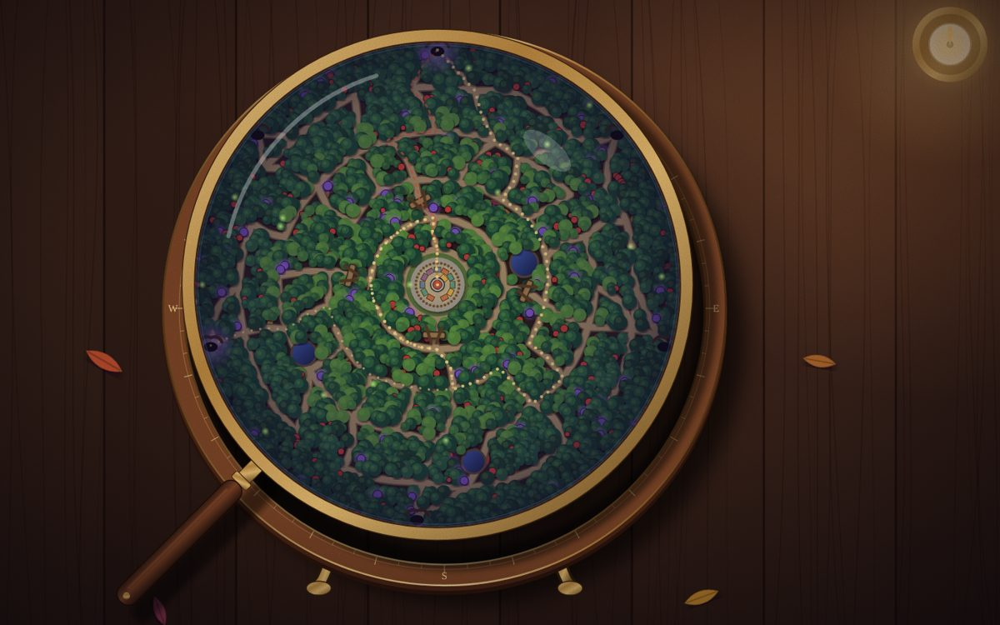

# Glasswood

A cosy, slightly mysterious tower defence inside a terrarium globe on a candle-lit desk.

A tiny village called Emberfold holds out night after night against goblins, wolves and stranger things that crawl out of burrows in the soil. Look into the globe in three ways:

- **Wilds:** the bare globe, with the whole miniature world inside. Plan expeditions.
- **Watch:** a reading glass over the forest around the village. Block forest paths with barricades and watch the night.
- **Hearth:** a tilted loupe over the village itself. Restore buildings and look after villagers, who are trading cards.

The interface is the desk: worn notes, a leather index card, wax seals and a deck of cards.

## Status

Milestone 1 is under way. All three views work: the Watch is playable (train the tower, mend the walls, block forest paths with up to three barricades and watch goblins and wolves walk the long way round), the Wilds shows the places in the globe, and Hearth lets you look over the village and its buildings. Scroll the mouse wheel (or pinch, or press 1, 2 and 3) to move between views; Settings (O) has sound, motion and save options. Expeditions, villager cards and restoring buildings come in later milestones.

Play at https://mycresta.github.io/glasswood/. Keys: N calls the night, X switches night speed, Space pauses.

The plan is in [docs/plan.md](docs/plan.md) and the design references are in [docs/design](docs/design/README.md) (also viewable at `/docs/design/` on the site).

The earlier 3D version (Three.js) is on the [`3d-prototype`](../../tree/3d-prototype) branch. Its simulation, saving and tests carry over into the 2D game.

## Running

There is no build step. Serve the folder with any static server, for example `python3 -m http.server`, and open it in a browser. `npm test` runs the simulation tests with Node 22. GitHub Pages deploys `main` automatically after the tests pass.

## How it is built

- `js/sim`: the deterministic simulation (clock, nights, path web, barricades, upgrades, offline time).
- `js/data`: balance numbers and the path web (`web.js`, exported from the design scripts).
- `js/render/watch.js`: the live SVG layer under the reading glass (routes, barricades, creatures, arrows).
- `js/ui/notes.js`: the notes on the desk.
- `assets/`: the static artwork under and over the glass, drawn by `tools/design/make_game_assets.py` and rasterized by `tools/design/rasterize.py`.

The interface is built from a small kit of parts (`js/ui/kit.js`) placed in named slots on the desk. Every part is shown on its own at [docs/ui/](https://mycresta.github.io/glasswood/docs/ui/).
